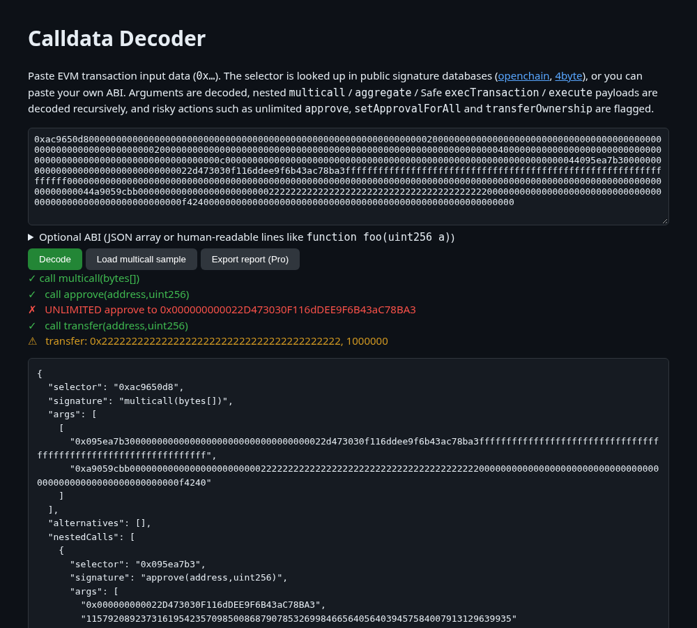

# Calldata Decoder

**Live:** https://dansgit2b.github.io/calldata-decoder/

Decode EVM transaction input **without an ABI**. Selectors are resolved through the public [openchain](https://openchain.xyz/signatures) and [4byte](https://www.4byte.directory) signature databases, or you can paste your own ABI.

- Recursive decoding of nested `bytes` calls: `multicall`, Multicall3 `aggregate`, Safe `execTransaction`, Universal Router / `execute`…
- Flags unlimited `approve`, `setApprovalForAll(true)`, `permit`, ownership, upgrade and Safe-owner changes.
- When signature databases return colliding candidates, each one that decodes cleanly is shown.
- Useful for reviewing multisig and governance proposals and for checking what a dApp is asking you to sign.

## Pro pass (0.10 USDC)
Decoding is free. The Pro pass adds Markdown report export of the call tree and its flags. All payments go straight to the Lumen Works wallet `0xee9790cB3960952F585379F831a89b4e00B4029A` (USDC on Base or Arc) and are checked on-chain by the page itself. No account and no backend. The code is MIT, so you could remove the check; the pass is an honest way to fund upkeep.

## More from Lumen Works
- [x402 Inspector](https://dansgit2b.github.io/x402-inspector/): decode and lint x402 payment headers ([repo](https://github.com/Dansgit2b/x402-inspector))
- [EIP-712 Inspector](https://dansgit2b.github.io/eip712-inspector/): see what a typed-data signature authorises, with hashes and signer recovery ([repo](https://github.com/Dansgit2b/eip712-inspector))
- [Calldata Decoder](https://dansgit2b.github.io/calldata-decoder/): decode EVM calldata and multicalls without an ABI, with risk flags ([repo](https://github.com/Dansgit2b/calldata-decoder))
- [Lumen Tab](https://dansgit2b.github.io/lumen-tab/): pay-as-you-go micropayment tabs for agents on Arc ([repo](https://github.com/Dansgit2b/lumen-tab))

MIT © Lumen Works.
